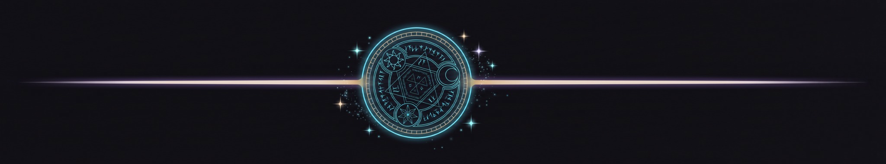
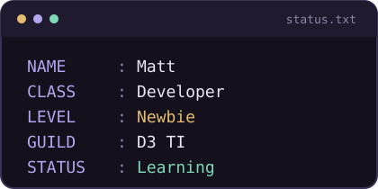

 

 

<h2>About Me</h2>

<table>
<tr>
<td width="60%">
<ul>
<li>Mahasiswa <b>D3 Teknologi Informasi</b></li>
<li>Tertarik pada <b>Web Development</b> dan <b>Mobile Development</b></li>
<li>Gamer yang menikmati dunia <b>gaming</b> dan <b>anime</b></li>
<li>Masih belajar, setiap hari berusaha jadi lebih baik</li>
</ul>
</td>
<td width="40%" align="center">

</td>
</tr>
</table>

<h2>My Tech Stack</h2>

<b>Backend</b>
 

  

<b>Mobile</b>
 

  

<b>Database &amp; Tools</b>
 

<h2>TOP Anime &amp; Gaming</h2>

<table>
<tr>
<th>Favorite Anime</th>
<th>Favorite Games</th>
</tr>
<tr>
<td align="center"><b>Mushoku Tensei</b></td>
<td align="center"><b>Valorant</b></td>
</tr>
<tr>
<td align="center"><b>86: Eighty-Six</b></td>
<td align="center"><b>Minecraft</b></td>
</tr>
<tr>
<td align="center"><b>Frieren: Beyond Journey's End</b></td>
<td align="center"><b>Roblox</b></td>
</tr>
</table>

<h2>Current Adventures</h2>

<pre>
quest_log:
  - Belajar membangun project web dengan Laravel dan MySQL
  - Eksplorasi pengembangan aplikasi mobile dengan Flutter
  - Memperdalam Java dan Spring Boot
  - Rutin push ke GitHub, jaga streak tetap menyala
</pre>

<h2>GitHub Stats</h2>

 

<h2>My Philosophy</h2>

<blockquote>
<i>"It's not about being the strongest from the start.</i>
  
<i>It's about becoming stronger every day."</i>
</blockquote>

<h2>Join My Party</h2>

<i>Mau ngobrol soal coding, anime, atau mabar? Kirim pesan ke guild-ku!</i>

  

  

<table>
<tr>
<td align="center"><b>Facebook</b></td>
<td align="center"><b>Discord</b></td>
<td align="center"><b>LinkedIn</b></td>
</tr>
<tr>
<td align="center"><a href="https://www.facebook.com/share/1FrQdUAuPB/">Matthew</a></td>
<td align="center"><a href="https://discordapp.com/users/733961538666233897">Kirim DM</a></td>
<td align="center"><a href="https://www.linkedin.com/in/matthew-samosir-a481642b2">Matthew Samosir</a></td>
</tr>
</table>

 

<pre>
contact_log:
  - Sosial &amp; pertemanan   -> Facebook
  - Ngobrol &amp; mabar       -> Discord
  - Karier &amp; networking   -> LinkedIn
</pre>

<h3>Thanks for visiting my profile!</h3>

<i>Feel free to explore my repositories and follow my journey.</i>

  

